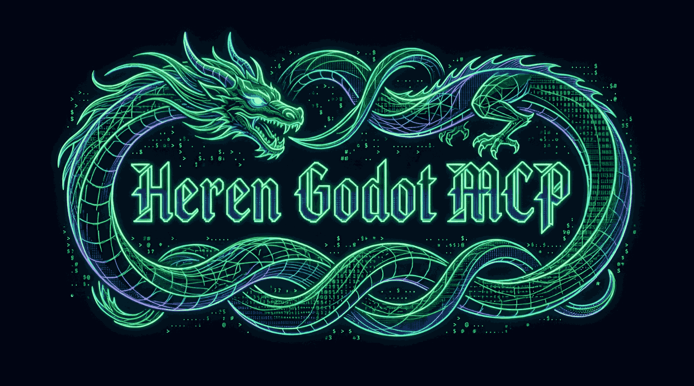

<div align="center">



<p>
  <a href="README.md">🇪🇸 Español</a> •
  <a href="README.en.md">🇬🇧 English</a>
</p>

</div>

---

> *"La técnica es una actividad compositora o destructora, violenta, y esto es lo que Aristóteles llamaba la poiesis, la poesía, precisamente."* — **Gustavo Bueno**

---

<div align="center">

# ⚡ Heren Godot MCP v5.0

**Plus Ultra: el agente ya no pregunta QUÉ herramienta llamar — escribe el código.**

Servidor MCP de alto rendimiento para Godot Engine 4.x, escrito en Rust.
Conecta un agente de IA al editor vivo — no a archivos, no a CLI efímeras —
para que cree escenas, muta nodos, anime esqueletos, escriba UI, valide y deshaga
con un `Ctrl+Z` cualquier cosa que se haya inventado.

<p>
  <a href="https://github.com/CerebroCanibalus/heren-mcp/issues">🐛 Issues</a> ·
  <a href="CHANGELOG.md">📋 CHANGELOG</a> ·
  <a href="AGENTS.md">📖 AGENTS.md</a>
</p>

</div>

---

## 🐉 Por qué v5.0 cambia las reglas

Antes, el dilema del agente ante una mutación compleja era un laberinto: elegir
entre 30+ tools tipadas, adivinar args por action, rezar para que el schema
aceptara la estructura. El traductor coder→handler se comía la mitad del fix-loop.

**v5.0 introduce Worker-First (W4)** — el corazón del cambio desde v4.9: el agente
escribe un worker GDScript corto contra la API real de Godot, y nosotros lo
ejecutamos con red transaccional.

```
parse-check previo
   ↓
snapshot del .tscn → .heren/backup/
   ↓
worker.run(ctx)         ← ctx.own · ctx.instance_scene · ctx.template · ctx.coords
   ↓
¿ctx.mark_modified()?   ← si NO, no se guarda NADA (escena original intacta)
   ↓
post-validación
   ↓
si falla → restaurar snapshot → receipt con diagnóstico
```

Una llamada mal escrita no rompe tu escena. Y `scene_script/inspect` (W4b) le da
al agente el árbol + huesos + animaciones + materiales **antes** de escribir el
worker. Cero round-trips ciegos.

---

## 🎯 Qué hace distinto a Heren

| Capacidad | Cómo lo resuelve |
|---|---|
| **Editor vivo, no headless** | `EditorPlugin` real dentro de Godot. Viewports 2D/3D reales, Undo/Redo real, EditorFileSystem real. |
| **Worker GDScript transaccional** | El agente escribe código contra la API de Godot — sin traductor. Falla ⇒ escena intacta. |
| **Proactividad en cada respuesta** | Toda mutación devuelve coords en su tier correcto y errores con `parent_children[]`. |
| **Visión en 3 niveles** | Coords textuales (~20-100 tok) → ASCII → viewports reales. Imagen solo si el texto no basta. |
| **Schema sin trampas** | Solo `action` es required. Cero `-32602` por parámetros que no aplican. |
| **Rust sobre FlojoMCP** | ~11 MB release, arranque instantáneo, schemas compile-time. |
| **Cero telemetría** | Por defecto y para siempre. |
| **LSP bridge incluido** | `heren-server lsp-bridge` para OpenCode — diagnósticos con backoff y reconexión. |

---

## 🆚 Frente a otros MCPs (julio 2026)

| Capacidad | Coding-Solo<br>4.5k★ MIT | Hi-godot<br>868★ MIT | GoPeak<br>227★ MIT | Fennara<br>191★ MIT | Godot MCP Pro<br>473★ $15 | **Heren v5.0**<br>Rust 11MB |
|---|:---:|:---:|:---:|:---:|:---:|:---:|
| Modo de operación | CLI headless | Editor WS | `npx` + addon | Addon + daemon | Editor (pago) | **EditorPlugin vivo vía WS** |
| **Undo/Redo real** | ❌ | ✅ | ❌ | ✅ transaccional | ✅ | **✅ `EditorUndoRedoManager`** |
| **Señales connect/list** | ❌ | ✅ | ❌ | ✅ | ✅ | **✅ `signal`** |
| **AnimationPlayer/Tree** | ❌ | parcial | ❌ | parcial | ✅ 6 tools | **✅ 25+ actions** |
| **Esqueletos 2D/3D + IK** | ❌ | parcial | ❌ | ❌ | parcial | **✅ pose, rest, skin, FABRIK, IK 3D** |
| **Shaders .gdshader** | ❌ | ✅ | parcial | ✅ | ✅ | **✅ + material/uniform/apply** |
| **Tilemap** | ❌ | ✅ | ❌ | parcial | ✅ | **✅ set_cell/terrain/pattern** |
| **UI 2D + Themes** | ❌ | parcial | ❌ | parcial | ✅ | **✅ `ui` + 6 templates + theme** |
| **Visión de la escena** | ❌ | screenshots | runtime | ❌ | screenshots | **✅ jerarquía: coords → ASCII → reales** |
| **LSP diagnostics** | ❌ | ❌ | ✅ propio | ❌ | ❌ | **✅ `lsp-bridge` para OpenCode** |
| **Batch / orquestación** | ❌ | ❌ | ❌ | ✅ loop | ✅ | **✅ `orchestrate` + `scene_script`** |
| **Agent GDScript worker** | ❌ | ❌ | ❌ | ✅ patch-rerun | ❌ | **✅ `scene_script/run` con snapshot** |
| **Vista READ-ONLY sin worker** | ❌ | ❌ | ❌ | ❌ | ❌ | **✅ `scene_script/inspect` (W4b)** |
| **Receipt proactivo** | ❌ | ❌ | ❌ | ❌ | ❌ | **✅ `aggregates` + tier dinámico** |
| **Runtime externo** | Node.js | Python | Node.js | Python | Node.js | **Rust nativo** |
| **Telemetría** | opt-in | opt-out ⚠️ | ninguna | ninguna | sí | **ninguna, para siempre** |

---

## ⚡ Quickstart

```bash
git clone https://github.com/CerebroCanibalus/heren-mcp.git
cd heren-mcp

# Opción A: instalador automático (compila + registra MCP + verifica)
python scripts/install_mcp.py

# Opción B: manual
cargo build --release
# → target/release/heren-server.exe (~11 MB)
```

### Configuración MCP

```jsonc
{
  "mcpServers": {
    "heren": {
      "command": "path/to/heren-server.exe",
      "environment": {
        "GODOT_EXE": "D:/Godot/Godot_v4.6.1-stable_win64.exe"
      }
    }
  }
}
```

> El server habla **NDJSON por stdio** (framing MCP estándar). El primer tool call
> con `project_path` auto-lanza Godot y carga el plugin — sin tool de sesión previa.
> `HEREN_AUTO_LAUNCH=0` para abrir Godot manualmente.

### Variables de entorno

| Variable | Default | Uso |
|----------|---------|-----|
| `GODOT_EXE` | — | Ruta a Godot (obligatoria) |
| `HEREN_AUTO_LAUNCH` | `1` | `0` deshabilita auto-launch |
| `HEREN_DEFAULT_PROJECT` | — | Proyecto por defecto (si no, `last_project`) |
| `HEREN_PLUGIN_SOURCE` | `addons/heren/` | Ruta al plugin fuente |
| `HEREN_LOG_FILE` | — | Log opcional (jamás inunda stderr) |

---

## 🚀 Flujo real de uso

### 1. Worker GDScript (recomendado para todo)

```gdscript
# res://.heren/tmp/workers/character.gd  (lo escribe el agente)
@tool
extends RefCounted
func run(ctx) -> void:
    var root := ctx.get_scene_root()
    var rig := Node3D.new()
    rig.name = "Rig"
    ctx.own(root.add_child(rig))            # transaccional
    var skel := Skeleton3D.new()
    skel.name = "Skel"
    ctx.own(rig.add_child(skel))
    for bone_name in ["Hip", "Spine", "Head", "L_Arm", "R_Arm"]:
        skel.add_bone(NamedBone(bone_name))
    ctx.mark_modified()                     # requerido para guardar
    ctx.snapshot_subtree("./Rig", 2)       # adjuntar al receipt
```

```python
# Desde el agente
godot_scene_script(action="run", code=<code>, save=True, tier=2)
# → {
#     "ok": true, "ran": true, "scene_saved": true,
#     "coords": {
#       "root": {<coord tier 2>},
#       "touched": ["./Rig", "./Rig/Skel"],
#       "aggregates": {
#         "skeletons_3d": [{"path": "./Rig/Skel", "bone_count": 5,
#                           "bones": ["Hip","Spine","Head","L_Arm","R_Arm"]}],
#         "subtrees": [{"path": "./Rig", "tier": 2, "tree": {...}}]
#       }
#     }
#   }
```

El agente **no re-inspecciona**. El receipt ya trae huesos, materiales, animaciones.
Y si tocó un `Skeleton3D`, el tier efectivo sube automático a 3.

### 2. Inspect READ-ONLY antes de escribir

```python
godot_scene_script(action="inspect", scene_path="res://levels/forest.tscn", tier=1)
# → { "opaque_packed_scenes": [],
#     "aggregates": { "skeletons_3d": [...], "animations": [...], ... },
#     "scene_node_count": 87 }
```

### 3. UI 2D con templates (1 llamada)

```python
godot_ui(action="create", template="health_bar", parent_path="CanvasLayer",
         layout="bottom_center",
         properties={"color": {"r": 0.9, "g": 0.2, "b": 0.2, "a": 1.0},
                     "label": "HP 100/100"})

# 6 templates listos: health_bar · crosshair · dialogue_box ·
#                     score_label · boss_bar · inventory_slot
```

### 4. Debug con errores reales

```python
godot_debug(action="run_scene")              # play
godot_debug(action="output", filter="error") # errores del juego + del editor
# → "E 0:00:06:695 global.gd:7 @ get_playstate(): Node not found..."
```

---

## 🛠️ Las 15 tools (90+ acciones)

> v5.0: las tools que el agente rara vez invocaba (`animation/tree_*`, `skeleton/*`,
> `tilemap/*`, `shader/material`, `node/move`...) se **archivaron**. El worker
> las cubre con ~10 líneas de GDScript en vez de un handler + schema + dispatcher.
> De ahí: 19 → 15.

| # | Tool | Acciones clave |
|---|------|----------------|
| 1 | `scene` | open, save, create, plan, orchestrate, validate, status, list |
| 2 | `node` | add, instantiate, remove, duplicate, rename |
| 2b | `node_query` | get_prop, get_info, get_children, find, **class_info**, **props_diff** |
| 2c | `node_props` | set_prop, set_props, array_append, array_remove |
| 3 | `resource` | create, read, update, delete, create_script, read_script, edit_script |
| 4 | `project` | create, setup_plugin, setting, autoload, input_map, shader_global |
| 5 | `shader` | create, edit, get, inspect, validate |
| 6 | `animation` | create_player, add_track, state_machine, one_shot, tween, record, … |
| 7 | `debug` | run_scene, stop_scene, output, breakpoint, vars, stack, profiler |
| 8 | `validate` | scene, script (con `parse_hints`), node, resource |
| 9 | `signal` | connect, disconnect, list |
| 10 | `visual` | coords, summary, ascii, spatial |
| 11 | `ui` | create, layout, canvas_layer, templates, get_info, theme |
| 12 | `filesystem` | scan, status, import_errors, exists, import |
| 13 | `health` | server + editor (+ `diagnose=true`) |
| 14 | `scene_script` | **run, list, inspect** — W4 + W4b inspect proactivo |

📖 Tabla completa con todas las acciones: [AGENTS.md §6](AGENTS.md).

> **Patrón de tool**: 1 tool = N acciones vía `action`. Solo `action` es required. Fin del laberinto de schemas.

## 🔬 Hecho con FlojoMCP

Heren se construye sobre [FlojoMCP](https://github.com/CerebroCanibalus/flojomcp),
framework MCP en Rust que genera schemas en compile-time, expone un WS local
para plugins externos y envía imágenes como `image_content` MCP estándar.
Sin runtime, sin Node, sin Python.

---

## 📚 Documentación

- 📖 [AGENTS.md](AGENTS.md) — Biblia del agente: bugs abiertos, decisiones, lecciones, gotchas.
- 📋 [CHANGELOG.md](CHANGELOG.md) — Historial de iteraciones.
- 📦 [docs/INSTALL.md](docs/INSTALL.md) — Instalación detallada.
- 🏗️ [docs/ARCHITECTURE.md](docs/ARCHITECTURE.md) — Arquitectura técnica.
- 🤝 [CONTRIBUTING.md](CONTRIBUTING.md) — Cómo contribuir.

---

## 📄 Licencia · 🤝 Contribuir

[MIT](LICENSE) © 2026 Heren MCP Contributors. Lee [CONTRIBUTING.md](CONTRIBUTING.md):
todo cambio en `.gd` pasa por `scripts/validate_plugin.bat` antes de commitear.

---

<div align="center">

**Por los trabajadores y los iberófonos del mundo** 🌍

🇪🇸 🇲🇽 🇦🇷 🇨🇴 🇨🇱 🇵🇪 🇻🇪 🇪🇨 🇬🇹 🇨🇺 🇧🇴 🇩🇴 🇭🇳 🇵🇾 🇸🇻 🇳🇮 🇨🇷 🇵🇦 🇺🇾 🇪🇶 🇵🇷 🇬🇶 🇵🇹 🇧🇷 🇲🇿 🇦🇴 🇨🇻 🇲🇴 🇬🇼 🇸🇹 🇹🇱

*Porque la creación no debería estar limitada al inglés.*

⚡ **Plus Ultra: ir más allá.** 🌍

</div>

---

```
多謝垂注
⠀⣏⡱ ⣏⡉ ⣏⡱ ⡇ ⣎⣱   ⡷⢾ ⢇⡸
⠀⠧⠜ ⠧⠤ ⠇⠱ ⠇ ⠇⠸   ⠇⠸ ⠇⠸
https://ko-fi.com/general_beria
```
